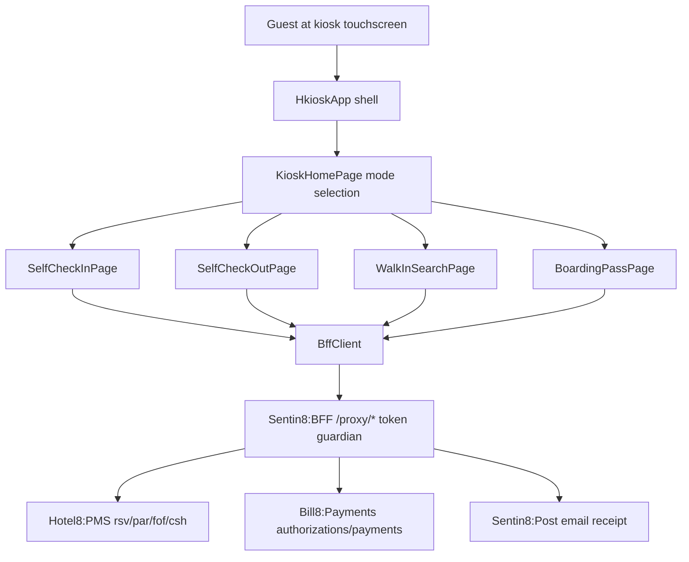

# README.md: Hotel8:eKiosk

## 1. Summary

Hotel8:eKiosk is the self-service lobby kiosk app - a Flutter application for
dedicated touchscreen terminals that let guests check in, check out, buy
add-ons, and pick up keys without front-desk interaction. It rides the same
PMS front-office/cashiering proxy surfaces as eGuest plus the Payments proxy
for card capture, and is the hardware-terminal counterpart to eGuest's mobile
check-in/out.

## 2. Motivation

Lobby queues are the visible cost of routine check-in/out work. eKiosk absorbs
the routine transactions (identify reservation → review → pay → cut keys /
settle folio → receipt) so the front desk handles only exceptions. Running on
Sentin8 platform rails means the kiosk is property-branded, env-scoped, and
audited like every other surface, and its key dispensing reuses the PMS key
domain the same way eGuest's digital keys do - one key model, two form factors.

## 3. Architecture & High-Level Design

Five screens over one client: mode selection, self check-in, self check-out,
walk-in search, and boarding-pass/key collection. `KioskMode` enumerates the
terminal modes; sessions (`KioskSession`) wrap each transaction so the
hardware steps (card, print, encode) stay per-session.

## 4. Key Traits and Data Structures

* `BffClient` - typed wrappers for kiosk flows: reservation lookup by
  last-name/confirmation, availability (walk-in), packages, payments
  (authorization + capture), front-office check-in, folio read, check-out,
  email receipt, boarding pass.
* `KioskMode` + `KioskSession` - mode selection and the per-transaction
  session state that sequences identify → options → payment → key/receipt.
* `SelfServiceReservation` / `KioskCheckIn` / `KioskCheckOut` - the check-in
  and check-out aggregates (steps completed, room, amount, add-ons).
* `AddOn` - the kiosk add-on catalog items presented during check-in with
  pricing.
* `WalkInSearch` / `WalkInRoom` - availability-driven walk-in funnel.
* `KioskFolio` / `KioskFolioItem` - check-out folio review projection.
* `BoardingPass` - the key-issuance/completion artifact (room + printable
  summary); the "boarding pass" metaphor for the kiosk slip.

## 5. Rationale, Trade-offs, and Alternatives

* **Guest identifies by reservation facts, not login** - kiosk users are
  transient; name + confirmation number (or QR) resolves the stay.
  Rejected: accounts/sign-in at a lobby kiosk (friction with no custody
  benefit; session dies after each transaction by design).
* **Mode-selection shell with wizard pages** - each mode is a short wizard;
  `IndexedStack`-free navigation (push/pop per step) keeps state local and
  abortable. Rejected: persistent session across guests - violates the
  one-guest-per-session security posture.
* **Kiosk-folio projection separate from eGuest's** - the kiosk shows a
  settlement view (amount due → payment), not the full folio browser;
  separate type keeps the check-out payment flow minimal. Rejected: sharing
  the eGuest folio model (carries UX fields irrelevant to settlement).
* **BFF-only egress** - uniform with all hotel8 apps; the kiosk client is a
  limited-scope consumer of checkout/check-in/pay endpoints only.
* **Payment via Payments proxy only** - card data stays inside the PCI
  terminal + BFF path; the kiosk app never sees card material.

## 6. Internal Implementation & Invariants (Private Design)

* **Invariants:**
  * Kiosk flows always start from an explicit identification step; no flow
    assumes a "current guest".
  * `KioskSession` is per transaction; the shell resets it at flow completion
    or timeout.
  * Money and key state derive from server responses; the client displays,
    never decides (payment success and key encoding are server-confirmed).
  * Every path is `/proxy/*`; non-2xx ⇒ `BffException`.
  * Models round-trip; request/response pairs exist for check-in, check-out,
    payments, and boarding-pass issuance.
* The email-receipt step is optional per guest choice and rides the Post
  proxy; printing is a kiosk-hardware concern outside the web build.
* The client is closed at flow completion.

## 7. Unresolved Questions / Future Designs

* Hardware integration (payment terminal, key encoder, thermal printer) is
  designed-for via platform channels but absent from the web build; the
  kiosk deployment target needs a platform-channel-capable shell.
* Kiosk lockdown mode (fullscreen, app-blocking) is a deployment/platform
  concern outside the Flutter build.
* `/admin` configuration (modes, branding, add-on catalog, hardware status)
  is an RFW/admin-surface concern on the service side.
* Kiosk-originated Bus events (checkin:started/completed, key:collected,
  error:raised) are emitted by the PMS/service side on those journeys; the
  app itself remains event-free.

---

**Design attribution:** hotel8:ekiosk and its underlying concepts were designed by Hamid Jahanzad <Hamid@Jahanzad.com>.
